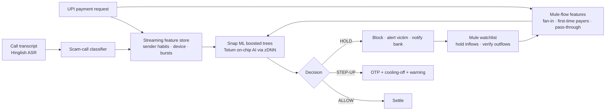

# Kavach — real-time UPI scam & mule-network shield on IBM LinuxONE

**IBM Z Datathon 2026 · Event code: SSF2026 · Theme: Real-Time AI for Critical Decisions**

Indians lose thousands of crores a year to "digital arrest", fake-KYC and account-takeover scams.
The money leaves the victim over UPI in seconds and is laundered through chains of **mule accounts**
within minutes. Rules like "large amount to a new payee" miss most of it and annoy honest users.

Kavach scores **every UPI payment inside the transaction**, in microseconds, and decides:
**ALLOW**, **STEP-UP** (OTP + cooling-off with a scam warning) or **HOLD** (block before settlement,
alert the victim). Each decision comes with human-readable reasons.


It looks at three things a normal per-transaction model cannot see together:

1. **The payment** — amount vs. the sender's habits, new payee, new device, odd hour, bursts.
2. **The money flow (mule graph)** — is the receiver collecting from many first-time payers?
   Is the sender forwarding money minutes after receiving it (pass-through)? Accounts that keep
   receiving held payments go on a **mule watchlist**: payments into them are held and their own
   outflows need verification.
3. **The scam call** — a Hinglish call-transcript classifier (char n-grams, robust to spelling
   like *paise/paisa/pese*) flags "CBI officer / digital arrest / KYC expire" calls; that risk is
   attached to the user for 2 hours and feeds the payment model.

## Results (held-out days, never seen in training)

Trained, evaluated and served on **IBM LinuxONE** (z17, machine type 9175, Ubuntu 24.04, s390x —
evidence in [`artifacts/linuxone/`](artifacts/linuxone)):

| Approach | Fraud caught | False alarms |
|---|---|---|
| Rule: amount > ₹20k **and** new payee | 28.2% | 2.0% |
| Per-transaction ML (same model, no graph/call features) | 79.6% | 0.1% |
| **Kavach** (+ mule-flow + scam-call signals) | **97.3%** | **0.1%** |

PR-AUC 0.992 on 33,538 unseen payments (554 frauds). Full live replay on LinuxONE:
**98.4% of fraud payments stopped, 96.2% of the money victims sent protected, only 0.046% of
legitimate payments held** (another 0.11% get an OTP step-up). Training the same code on an x86
laptop gives 96.2% vs 82.1% (PR-AUC 0.991) — small floating-point differences between platforms.

Latency, full in-transaction path (feature lookup + model + decision), one payment at a time:

| Platform | Inference engine | p50 | p99 | Throughput (batch 64) |
|---|---|---|---|---|
| IBM LinuxONE z17 | Snap ML compressed trees on the z17 cores | **28 µs** | 52 µs | ~285k txn/s |
| IBM LinuxONE z17 | Snap ML → zDNN on the **Telum on-chip AI accelerator** (NNPA) | 49 µs | 72 µs | ~62k txn/s |
| Laptop x86-64 | Snap ML compressed trees | 26 µs | 64 µs | ~338k txn/s |

The accelerator path gives **bit-identical predictions** (max difference 0.0, 100% decision agreement
on all 33,538 test payments). For our compact 300-tree model the overhead of handing work to the
accelerator outweighs its compute advantage, so the z17 cores are faster today; both paths stay
far inside a UPI authorisation budget. Kavach uses the accelerator by default
(`KAVACH_TREE_FORMAT=auto`) and can pin the CPU path with `KAVACH_TREE_FORMAT=compress_trees`.
(Ubuntu ships zDNN 1.0.1; newer zDNN releases target z17 directly.)

## How it uses IBM Z / LinuxONE

- **Runs natively on IBM LinuxONE (s390x)** — trained, tested (15/15) and served on a LinuxONE
  Community Cloud VM on an IBM z17.
- **IBM Snap ML** gradient-boosted trees. The trained model is exported to PMML and re-imported with
  `import_model(..., tree_format="auto")`; with IBM's **zDNN** library installed, Snap ML compiles
  the trees to zDNN tensors and runs inference on the **Telum on-chip Integrated Accelerator for AI**
  (the `nnpa` CPU facility) — the same chip that runs the bank's payment workload, so scoring
  happens *inside* the transaction with no network hop to an AI server. We benchmarked that path
  against the z17 cores and verified identical decisions.
- **Why Z for this:** most of the world's card and bank transactions already run on IBM Z.
  Scoring 100% of payments in-line (not a sample, not after settlement) needs the latency,
  throughput and reliability Z is built for, and sensitive payment data never has to leave the
  platform (no external AI API; Z offers pervasive encryption for data at rest and in flight).

## Architecture



## Run it

Laptop (x86) or LinuxONE:

```bash
# LinuxONE (Ubuntu/RHEL on s390x): installs deps, trains, benchmarks
./setup_linuxone.sh

# or on any machine with Python 3.10-3.12
python -m venv .venv && .venv/bin/pip install -r requirements.txt
.venv/bin/python -m kavach.train      # synthetic world + features + Snap ML model (~15 s)
.venv/bin/python -m kavach.bench      # latency / throughput (CPU vs zDNN on Z)
.venv/bin/python -m pytest -q tests    # no-leakage, mule, scam-call and API checks (pip install pytest httpx)
.venv/bin/uvicorn kavach.server:app --host 127.0.0.1 --port 8000
```

Open `http://localhost:8000` — the dashboard replays the two held-out days as a live stream.

On the LinuxONE VM keep the server on localhost with an API key and view it through an SSH tunnel,
so no port is opened to the internet:

```bash
# on the VM
export KAVACH_API_KEY=$(openssl rand -hex 16); echo $KAVACH_API_KEY
.venv/bin/uvicorn kavach.server:app --host 127.0.0.1 --port 8000
# on your laptop
ssh -i ~/.ssh/linuxone -L 8000:127.0.0.1:8000 linux1@<vm-ip>
# browse http://localhost:8000/#key=<key>   (the key stays in the URL fragment, never sent in URLs/logs)
```

## Security (it's a payments system)

| Control | How |
|---|---|
| Fail-safe, not fail-open | If scoring throws, the payment is **stepped up**, never silently allowed |
| Model integrity | SHA-256 of the model file is pinned at training time; the server refuses to start on a mismatch |
| No pickle | Data files are CSV; the call model is retrained deterministically at start-up — nothing executes code on load |
| AuthN | Optional `KAVACH_API_KEY`: all `POST /api/*` need `X-API-Key` (constant-time compare); the WebSocket must send the key as its first message |
| Input validation | Strict schemas: account-ID pattern and length, `0 < amount ≤ 1e8`, no NaN/Infinity, no unknown fields, sender ≠ receiver |
| Abuse limits | Per-IP rate limit on `/api/*` (HTTP 429), max 50 dashboard sockets, slow sockets dropped |
| Browser hardening | CSP (no inline scripts), `X-Frame-Options: DENY`, `nosniff`, `no-referrer`, SRI hash on the CDN script, all dynamic text HTML-escaped |
| No CORS, no docs | Other origins can't call the API from a browser; `/docs` and `/openapi.json` are off unless `KAVACH_DOCS=1` |
| Audit trail | Every API decision and every replay flag is appended to `artifacts/audit.jsonl` with time, reasons and model hash |
| Framing resistance | The mule watchlist needs held payments from ≥ 2 different senders, expires after 72 h, and only **steps up** the suspect's own outflows, so an attacker who pushes dirty money into an innocent account can't freeze them |
| Network exposure | Bind to `127.0.0.1`, view through an SSH tunnel; SSH is key-only on LinuxONE Community Cloud |
| Supply chain | Python dependencies pinned; `pip-audit`: no known vulnerabilities; `bandit`: no high findings |
| Privacy | Synthetic data only; no external AI APIs; call transcripts are kept in memory only and are not logged |

Tests: `python -m pytest -q tests` covers no-leakage, mule pass-through, the scam-call path, API
validation, auth, security headers, rate limiting, fail-safe behaviour, model tampering, the
framing attack and new-device draining.

### API

```bash
# a scam call reaches the user (add -H "X-API-Key: $KAVACH_API_KEY" when a key is set)
curl -X POST localhost:8000/api/call -H 'Content-Type: application/json' \
  -d '{"user":"U00044","transcript":"main CBI officer bol raha hoon, aap digital arrest mein ho, paise transfer karo"}'
# the same user then tries to pay someone new
curl -X POST localhost:8000/api/txn -H 'Content-Type: application/json' \
  -d '{"sender":"U00044","receiver":"U01234","amount":15000}'
# -> {"decision":"STEP_UP"/"HOLD","risk":...,"reasons":[...],"latency_ms":...}
```

## Data

Real UPI data with mule labels is not public, so `kavach/simulate.py` builds a reproducible
synthetic UPI world (5,000 users, merchants, kirana shops, 90 mule + 25 cash-out accounts, 7 days,
~117k payments, ~14k calls) with realistic **hard negatives**: friends pooling trip money and
paying an agent minutes later, legit large first-time payments, phone changes, night owls,
genuine bank-fraud-alert calls, older mule accounts, and scam calls captured for only 55% of
victims. Training uses days 1–5, evaluation days 6–7. Features are computed by the same streaming
code used live, strictly from past events (no leakage).

**Limitations:** synthetic data; the call classifier is trained on template-generated Hinglish
and needs real transcripts; the watchlist rule is simple; amount-splitting by a fresh account with
no scam call and no mule signals (e.g. 6 × ₹4,999 to a new person) is still allowed — a cumulative
new-payee limit is the next policy to add. A production deployment also needs mTLS between bank
systems, a secrets manager instead of an env var, a real analyst review queue and DPDP-compliant
data retention. Next steps: graph neural features over
the full account graph, federated training across banks, on-device ASR.

## Repo layout

```
kavach/simulate.py   synthetic UPI world + scam campaigns + mule layering
kavach/calls.py      Hinglish scam-call generator + classifier
kavach/features.py   streaming feature store (shared by training and live scoring)
kavach/train.py      training, evaluation, ablation
kavach/engine.py     in-transaction scoring, reasons, policy, mule watchlist
kavach/server.py     FastAPI + WebSocket live replay
kavach/static/       dashboard (index.html + app.js, CSP-clean)
tests/               pytest suite incl. security and abuse cases
kavach/bench.py      latency / throughput benchmark (CPU vs Telum zDNN)
setup_linuxone.sh    one-shot LinuxONE setup
```

## Open-source used

IBM Snap ML (https://pypi.org/project/snapml/), scikit-learn, NumPy, pandas, SciPy, FastAPI,
Uvicorn, Cytoscape.js. No external datasets or AI APIs.
