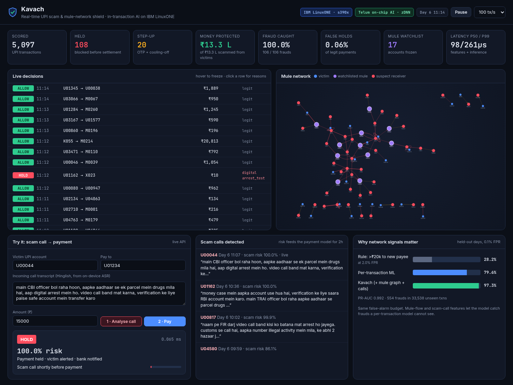

# Kavach — real-time UPI scam & mule-network shield on IBM LinuxONE

**IBM Z Datathon 2026 · Event code: SSF2026 · Theme: Real-Time AI for Critical Decisions**

Indians lose thousands of crores a year to "digital arrest", fake-KYC and account-takeover scams.
The money leaves the victim over UPI in seconds and is laundered through chains of **mule accounts**
within minutes. Rules like "large amount to a new payee" miss most of it and annoy honest users.

Kavach scores **every UPI payment inside the transaction**, in microseconds, and decides:
**ALLOW**, **STEP-UP** (OTP + cooling-off with a scam warning) or **HOLD** (block before settlement,
alert the victim). Each decision comes with human-readable reasons.



It looks at three things a normal per-transaction model cannot see together:

1. **The payment** — amount vs. the sender's habits, new payee, new device, odd hour, bursts.
2. **The money flow (mule graph)** — is the receiver collecting from many first-time payers?
   Is the sender forwarding money minutes after receiving it (pass-through)? Accounts that keep
   receiving held payments go on a **mule watchlist** and their outflows are frozen.
3. **The scam call** — a Hinglish call-transcript classifier (char n-grams, robust to spelling
   like *paise/paisa/pese*) flags "CBI officer / digital arrest / KYC expire" calls; that risk is
   attached to the user for 2 hours and feeds the payment model.

## Results (held-out days, never seen in training)

| Approach | Fraud caught | False alarms |
|---|---|---|
| Rule: amount > ₹20k **and** new payee | 28.2% | 2.0% |
| Per-transaction ML (same model, no graph/call features) | 82.1% | 0.1% |
| **Kavach** (+ mule-flow + scam-call signals) | **96.2%** | **0.1%** |

PR-AUC 0.991 on 33,538 unseen transactions (554 frauds). In the live replay the dashboard shows
~98% of fraud transactions stopped, while holding only ~0.1–0.3% of legitimate payments.

Latency, full in-transaction path (feature lookup + model + decision), one payment at a time:

| Platform | Inference engine | p50 | p99 | Throughput (batch 1024) |
|---|---|---|---|---|
| Laptop x86-64 | Snap ML compressed trees (CPU) | 26 µs | 64 µs | ~344k txn/s |
| IBM LinuxONE (s390x) | Snap ML → zDNN on Telum AI accelerator | see `artifacts/bench_s390x.json` | | |

## How it uses IBM Z / LinuxONE

- **Runs natively on IBM LinuxONE (s390x)** — trained and served on a LinuxONE Community Cloud VM.
- **IBM Snap ML** gradient-boosted trees. The trained model is exported to PMML and re-imported with
  `import_model(..., tree_format="auto")`; on z16/z17 Snap ML compiles the trees to **zDNN tensors
  and runs inference on the on-chip Integrated Accelerator for AI (Telum)** — the same chip that
  sits next to the bank's core payment workload, so scoring happens *inside* the transaction
  instead of after it. Same code and model file fall back to CPU elsewhere.
- **Why Z for this:** most of the world's card and bank transactions already run on IBM Z.
  Scoring 100% of payments in-line (not a sample, not after settlement) needs the latency,
  throughput, and reliability Z is built for; sensitive payment data never leaves the platform
  (pervasive encryption, no external AI API).

## Architecture


## Run it

Laptop (x86) or LinuxONE:

```bash
# LinuxONE (Ubuntu/RHEL on s390x): installs deps, trains, benchmarks
./setup_linuxone.sh

# or on any machine with Python 3.10-3.12
python -m venv .venv && .venv/bin/pip install -r requirements.txt
.venv/bin/python -m kavach.train      # synthetic world + features + Snap ML model (~15 s)
.venv/bin/python -m kavach.bench      # latency / throughput (CPU vs zDNN on Z)
.venv/bin/python -m pytest -q tests    # no-leakage, mule, scam-call and API checks (pip install pytest httpx)
.venv/bin/uvicorn kavach.server:app --host 0.0.0.0 --port 8000
```

Open `http://<host>:8000` — the dashboard replays the two held-out days as a live stream.

### API

```bash
# a scam call reaches the user
curl -X POST localhost:8000/api/call -H 'Content-Type: application/json' \
  -d '{"user":"U00044","transcript":"main CBI officer bol raha hoon, aap digital arrest mein ho, paise transfer karo"}'
# the same user then tries to pay someone new
curl -X POST localhost:8000/api/txn -H 'Content-Type: application/json' \
  -d '{"sender":"U00044","receiver":"U01234","amount":15000}'
# -> {"decision":"STEP_UP"/"HOLD","risk":...,"reasons":[...],"latency_ms":...}
```

## Data

Real UPI data with mule labels is not public, so `kavach/simulate.py` builds a reproducible
synthetic UPI world (5,000 users, merchants, kirana shops, 90 mule + 25 cash-out accounts, 7 days,
~117k payments, ~14k calls) with realistic **hard negatives**: friends pooling trip money and
paying an agent minutes later, legit large first-time payments, phone changes, night owls,
genuine bank-fraud-alert calls, older mule accounts, and scam calls captured for only 55% of
victims. Training uses days 1–5, evaluation days 6–7. Features are computed by the same streaming
code used live, strictly from past events (no leakage).

**Limitations:** synthetic data; the call classifier is trained on template-generated Hinglish
and needs real transcripts; the watchlist rule is simple. Next steps: graph neural features over
the full account graph, federated training across banks, on-device ASR.

## Repo layout

```
kavach/simulate.py   synthetic UPI world + scam campaigns + mule layering
kavach/calls.py      Hinglish scam-call generator + classifier
kavach/features.py   streaming feature store (shared by training and live scoring)
kavach/train.py      training, evaluation, ablation
kavach/engine.py     in-transaction scoring, reasons, policy, mule watchlist
kavach/server.py     FastAPI + WebSocket live replay
kavach/static/       dashboard
kavach/bench.py      latency / throughput benchmark (CPU vs Telum zDNN)
setup_linuxone.sh    one-shot LinuxONE setup
```

## Open-source used

IBM Snap ML (https://pypi.org/project/snapml/), scikit-learn, NumPy, pandas, SciPy, FastAPI,
Uvicorn, Cytoscape.js. No external datasets or AI APIs.
